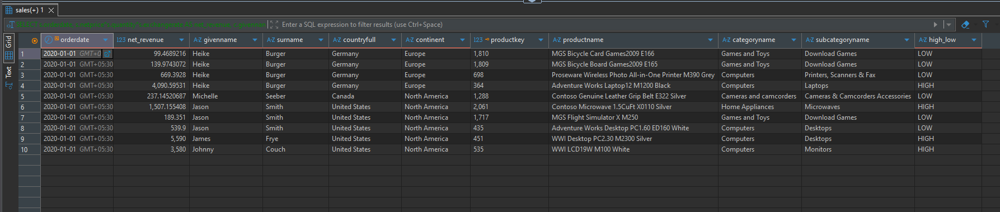
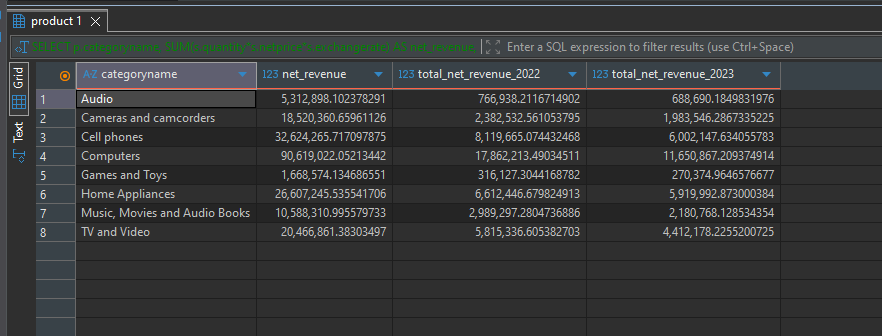
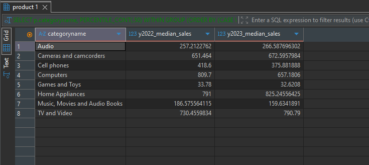
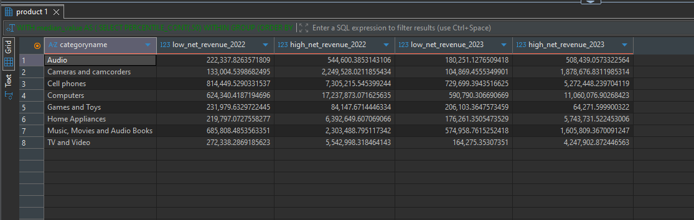
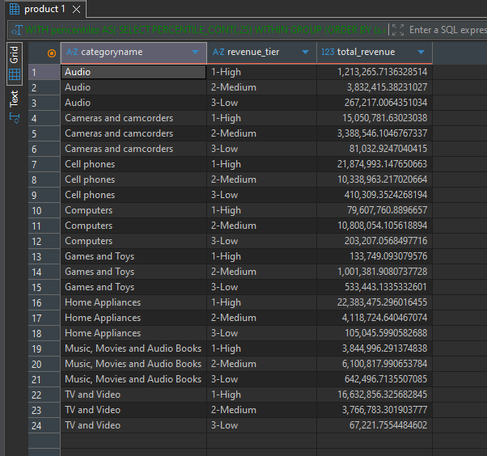

# Contoso Sales Analysis – Revenue and Product Analysis

This folder is part of the **SQL PROJECT → Contoso Sales Analysis** series.

It focuses on analyzing sales revenue, product category performance, median sales values, and revenue segmentation using SQL queries executed in **PostgreSQL**.

Each query examines a different aspect of product and revenue performance, with insights based on the actual query results.

---

## 📂 Folder Structure

```text
SQL PROJECT
│
└── Contoso Sales Analysis
    │
    └── 1.Revenue_and_Product_Analysis
        ├── 1.Line_Level_Sales_Revenue.sql
        ├── 2.Revenue_by_Product_Category.sql
        ├── 3.Median_Revenue_by_Product_Category.sql
        ├── 4.Revenue_Split_by_Median.sql
        ├── 5.Revenue_Tier_Segmentation.sql
        ├── README.md
        │
        └── result_snapshots/
            ├── 1.Line_Level_Sales_Revenue.png
            ├── 2.Revenue_by_Product_Category.png
            ├── 3.Median_Revenue_by_Product_Category.png
            ├── 4.Revenue_Split_by_Median.png
            └── 5.Revenue_Tier_Segmentation.png
```

---

## 🧩 Queries & Insights

### 1️⃣ Line-Level Sales Revenue

**File:** `1.Line_Level_Sales_Revenue.sql`

**Description:**

Calculates net revenue for individual sales lines from 2020 onward and includes related customer and product attributes, such as customer name, country, continent, product name, category, and subcategory.

Sales lines are also classified into high- and low-revenue groups.

**Result Snapshot:**



**Insights:**

- The output combines revenue values with customer geography and product details, allowing sales to be examined at an individual transaction-line level.
- The displayed records include products from categories such as Computers, Games and Toys, Home Appliances, and Cameras and Camcorders.
- The `high_low` field distinguishes sales lines classified as `HIGH` or `LOW`.
- This detailed dataset provides a foundation for category-level revenue aggregation and revenue segmentation in the subsequent queries.

---

### 2️⃣ Revenue by Product Category

**File:** `2.Revenue_by_Product_Category.sql`

**Description:**

Calculates total net revenue for each product category and compares revenue recorded in 2022 and 2023.

This analysis helps identify the categories contributing the most revenue and compare their performance across the two years.

**Result Snapshot:**



**Insights:**

- **Computers** generated the highest total revenue, approximately **90.62 million**, followed by **Cell Phones** at **32.62 million** and **Home Appliances** at **26.61 million**.
- **Games and Toys** generated the lowest total revenue among the eight categories, at approximately **1.67 million**.
- Every category recorded lower revenue in 2023 than in 2022 in the supplied results.
- Computers revenue declined from approximately **17.86 million in 2022** to **11.65 million in 2023**.
- Cell Phones revenue declined from approximately **8.12 million** to **6.00 million** over the same period.
- These comparisons show differences in revenue contribution and year-over-year category performance, but do not by themselves explain the reasons for the declines.

---

### 3️⃣ Median Revenue by Product Category

**File:** `3.Median_Revenue_by_Product_Category.sql`

**Description:**

Calculates the median line-level net revenue for each product category in 2022 and 2023 using percentile-based SQL calculations.

The median provides a measure of the typical sales-line value that is less sensitive to extreme values than the mean.

**Result Snapshot:**



**Insights:**

- **Computers** had the highest median sales-line revenue in 2022, at approximately **809.70**.
- In 2023, **Home Appliances** recorded the highest median, at approximately **825.25**.
- The median for Computers declined from **809.70 in 2022** to **657.18 in 2023**.
- Cell Phones median revenue declined from **418.60** to **375.88**.
- Home Appliances median revenue increased from **791.00** to **825.25**, while Cameras and Camcorders increased from approximately **651.46** to **672.60**.
- Games and Toys had the lowest median sales-line revenue in both years, declining from **33.78** to **32.62**.
- Comparing medians alongside total revenue helps distinguish overall category revenue from the value of a typical sales line.

---

### 4️⃣ Revenue Split by Median

**File:** `4.Revenue_Split_by_Median.sql`

**Description:**

Compares revenue from sales lines below the overall median with revenue from sales lines at or above the median for each product category in 2022 and 2023.

This analysis examines how revenue is distributed between lower- and higher-value sales lines within each category.

**Result Snapshot:**



**Insights:**

- In most categories, sales lines at or above the median contributed substantially more revenue than sales lines below the median.
- **Computers** generated approximately **17.24 million** from the higher group in 2022, compared with approximately **624,340** from the lower group.
- In 2023, Computers generated approximately **11.06 million** from the higher group and **590,790** from the lower group.
- **Games and Toys** showed the opposite pattern: the lower group contributed approximately **231,980 in 2022**, compared with **84,148** from the higher group.
- The same pattern continued in 2023, when the lower group contributed approximately **206,103**, compared with **64,272** from the higher group.
- This comparison highlights differences in revenue distribution across categories. The groups are defined relative to the median, not by fixed monetary thresholds.

---

### 5️⃣ Revenue Tier Segmentation

**File:** `5.Revenue_Tier_Segmentation.sql`

**Description:**

Segments sales lines into high-, medium-, and low-revenue tiers using the 75th and 25th percentiles, then aggregates net revenue for each tier within every product category.

This analysis helps compare revenue contribution across different sales-line value tiers.

**Result Snapshot:**



**Insights:**

- The **High** tier contributed the most revenue in categories such as Computers, Cell Phones, Home Appliances, Cameras and Camcorders, and TV and Video.
- Computers generated approximately **79.61 million** in the High tier, compared with approximately **10.81 million** in the Medium tier and **203,207** in the Low tier.
- Cell Phones generated approximately **21.87 million** in the High tier and **10.34 million** in the Medium tier.
- **Games and Toys** had its largest revenue contribution in the Medium tier, at approximately **1.00 million**, compared with **533,443** in the Low tier and **133,749** in the High tier.
- **Music, Movies and Audio Books** also generated more revenue in the Medium tier, approximately **6.10 million**, than in the High tier, approximately **3.84 million**.
- These results demonstrate that the revenue distribution across tiers differs by product category.

---

## 🧠 Key Takeaways

- **Category performance:** Computers generated the highest total revenue in the supplied results, while Games and Toys generated the lowest.
- **Year-over-year comparison:** All eight categories recorded lower revenue in 2023 than in 2022.
- **Median sales value:** Computers led in median sales-line revenue in 2022, while Home Appliances led in 2023.
- **Revenue distribution:** Sales lines at or above the median contributed more revenue in most categories, but Games and Toys showed the reverse pattern.
- **Percentile segmentation:** High-revenue sales lines dominate several major categories, whereas the Medium tier contributes most revenue in Games and Toys and Music, Movies and Audio Books.
- **Multiple perspectives:** Combining total revenue, median values, and tier-based analysis provides a more complete view of product performance than relying on a single metric.

---

## 🗄️ Database Info

- **Database:** Contoso sample sales database (`contoso_100k`)
- **Environment:** PostgreSQL
- **Queries Written & Executed In:** PostgreSQL / DBeaver
- **Data Areas Used:** Sales, Customer, Product, Product Category, Order Date, and Net Revenue fields

---

**Author:** Utkarsh Naik

**Project:** SQL PROJECT → Contoso Sales Analysis → Revenue and Product Analysis

**Date:** 2026