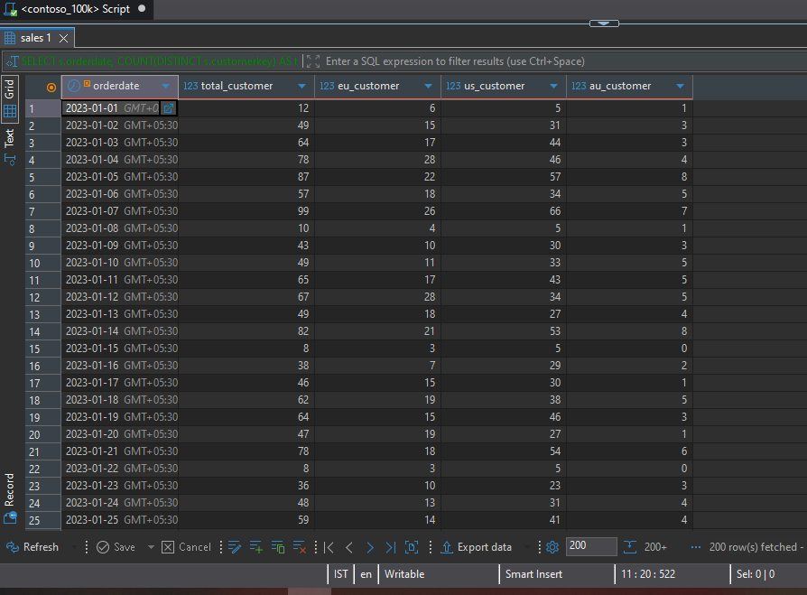
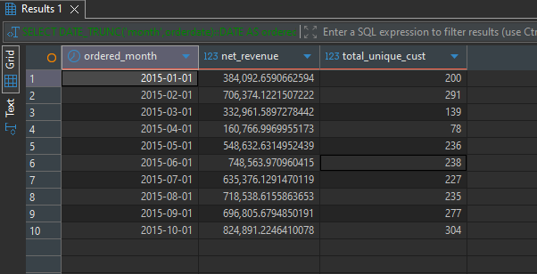
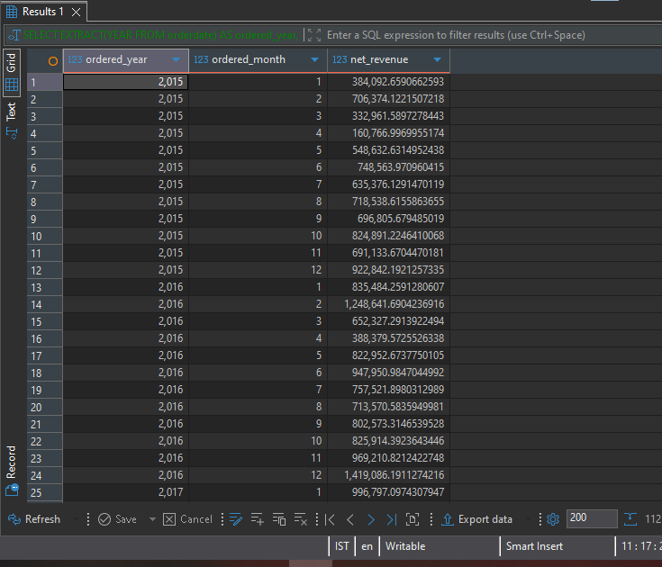
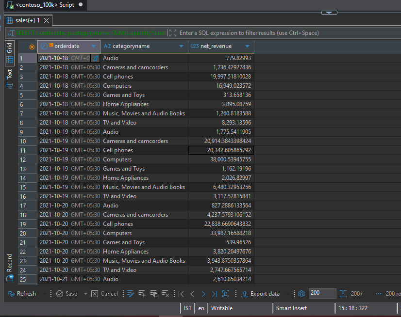
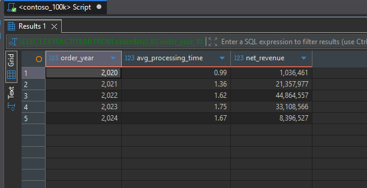

# Contoso Sales Analysis – Customer and Time Trends

This folder is part of the **SQL PROJECT → Contoso Sales Analysis** series.

It focuses on analyzing customer purchasing activity, monthly revenue, historical sales trends, and daily revenue by product category using SQL queries executed in **PostgreSQL**.

Each query is documented with its purpose and insights based on the supplied results.

---

## 📂 Folder Structure

```text
SQL PROJECT
│
└── Contoso Sales Analysis
    │
    └── 2.Customer_and_Time_Trends
        ├── 1.Daily_Customer_Activity_by_Continent.sql
        ├── 2.Monthly_Revenue_and_Customer_Counts.sql
        ├── 3.Revenue_by_Year_and_Month.sql
        ├── 4.Daily_Revenue_by_Product_Category.sql
        ├── README.md
        │
        └── result_snapshots/
            ├── 1.Daily_Customer_Activity_by_Continent.png
            ├── 2.Monthly_Revenue_and_Customer_Counts.png
            ├── 3.Revenue_by_Year_and_Month.png
            └── 4.Daily_Revenue_by_Product_Category.png
```

---

## 🧩 Queries & Insights

### 1️⃣ Daily Customer Activity by Continent

**File:** `1_daily_unique_customers_overall_and_by_continent_2023.sql`

**Description:**

Calculates the number of distinct customers purchasing on each date in 2023, both overall and by continent.

Helps examine daily customer activity and understand how purchasing activity is distributed geographically.

**Result Snapshot:**



**Insights:**

- The United States frequently contributes the largest daily customer count among the geographic segments shown in the results.
- Daily customer activity varies throughout the year, with some dates recording substantially more customers than others.
- Comparing customer counts across Europe, the United States, and Australia helps identify differences in geographic purchasing activity.

---

### 2️⃣ Monthly Revenue and Customer Counts

**File:** `2_monthly_net_rev_and_unique_customers.sql`

**Description:**

Calculates monthly net revenue alongside the number of distinct customers who purchased during each month.

This analysis combines revenue and customer metrics to support monthly business performance monitoring.

**Result Snapshot:**



**Insights:**

- Monthly revenue varies across the reported periods.
- The distinct customer count provides additional context for evaluating monthly revenue performance.
- Reviewing revenue alongside customer counts can help identify months where changes in sales and customer activity occur together.

**Note:** The supplied result output contains only part of the monthly series, so conclusions about the full historical trend require the complete query output.

---

### 3️⃣ Revenue by Year and Month

**File:** `3_net_revenue_by_year_month.sql`

**Description:**

Aggregates net revenue by year and month to examine historical sales performance over time.

The results can be used to compare monthly revenue across years and identify periods of higher or lower revenue.

**Result Snapshot:**



**Insights:**

- February 2022 recorded approximately **4.84 million** in net revenue in the supplied results.
- April 2023 recorded approximately **1.16 million** in net revenue.
- Monthly revenue differs across periods, making year-month comparisons useful for examining changes in sales performance.
- The output includes partial data for 2024, so those months should not be compared directly with complete calendar years.

---

### 4️⃣ Daily Revenue by Product Category

**File:** `4_daily_net_revenue_by_category_t5y.sql`

**Description:**

Calculates daily net revenue for individual product categories over a trailing five-year period.

The analysis provides a detailed view of how revenue varies by date and product category.

**Result Snapshot:**



**Insights:**

- Revenue is analyzed separately across categories such as Computers, Cell Phones, Home Appliances, and TV and Video.
- Daily revenue varies across both dates and product categories.
- The category-level breakdown supports comparisons of daily sales performance and can help identify periods of higher or lower revenue within individual categories.

---
### 5️⃣ Order Processing Time and Net Revenue by Year

**File:** `5_avg_delivery_time_and_net_revenue_6yr.sql`

**Description:**

Calculates the average order-to-delivery processing time and total net revenue for each order year over the recent six-year period.

This analysis helps evaluate yearly changes in processing time alongside revenue performance.

**Result Snapshot:**




**Insights:**

- **Revenue peaked in 2022**, reaching approximately 44.86 million, before declining in 2023.
- **Average processing time increased from 0.99 in 2020 to 1.75 in 2023**, then decreased slightly to 1.67 in 2024.
- Revenue declined from approximately 44.86 million in 2022 to 33.11 million in 2023, while average processing time increased from 1.62 to 1.75.
- The 2024 revenue total is lower than the 2023 total, but the 2024 data may cover only part of the year. Confirm the reporting period before making a full-year comparison.
- Comparing processing time and revenue together helps monitor operational performance, although the results alone do not establish a causal relationship between the two metrics.

## 🧠 Key Takeaways

- **Customer activity varies by geography:** Daily distinct customer counts help compare purchasing activity across the geographic segments in the dataset.
- **Revenue changes over time:** Monthly and year-month aggregations reveal differences in revenue across periods.
- **Customer metrics add context:** Evaluating distinct customer counts alongside monthly revenue provides a broader view of sales performance.
- **Product categories behave differently:** Daily category-level revenue makes it possible to examine sales patterns at a more granular level.

---

## 🗄️ Database Info

- **Database:** Contoso sample sales database
- **Environment:** PostgreSQL
- **Queries Written & Executed In:** PostgreSQL-compatible SQL environment
- **Data Areas Used:** Sales, Customer, Product, and Date-related fields

---

## ⚙️ Notes

- The analysis is based on the supplied SQL query results.
- Revenue values are presented in the units returned by the dataset; no currency conversion has been applied.
- The monthly revenue and distinct-customer output provided for Query 2 is incomplete, so full-series conclusions should be confirmed against the complete results.
- The year-month revenue results include partial data for 2024.
- Result snapshots should be saved in the `result_snapshots/` folder using the filenames shown above.
- Each `.sql` file should correspond to its respective result image for easy reference.

---

**Author:** Utkarsh Naik

**Project:** SQL PROJECT → Contoso Sales Analysis → Customer and Time Trends

**Date:** 2026