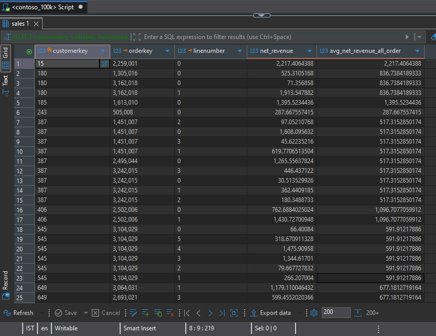
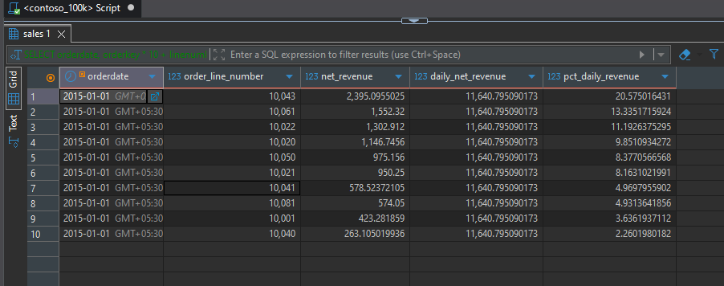
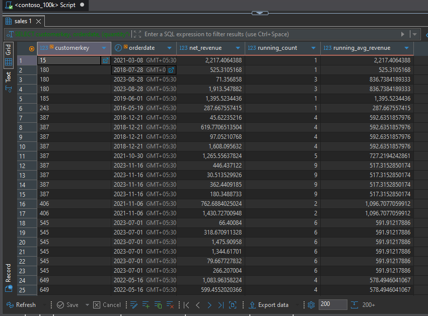
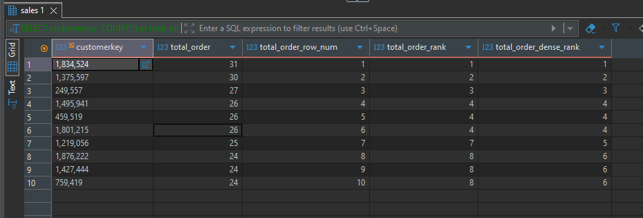
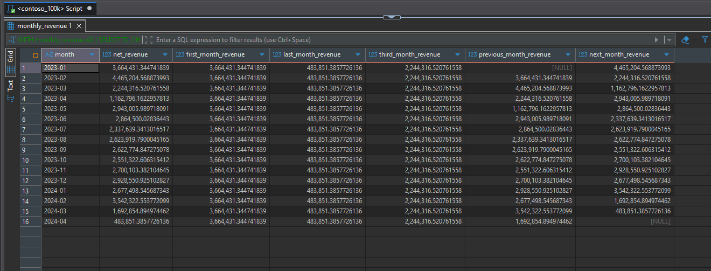
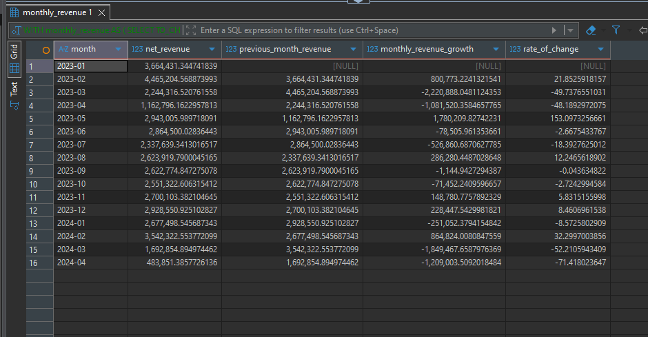
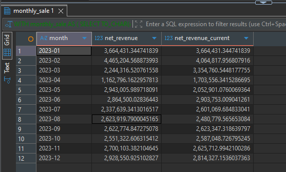
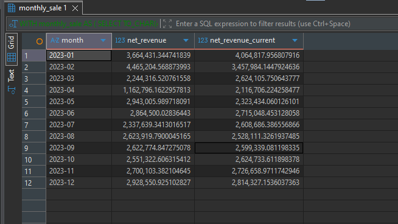

# Contoso Sales Analysis – Window Function Analysis

This folder is part of the **SQL PROJECT → Contoso Sales Analysis** series.

It focuses on analyzing customer-level sales performance, daily revenue contribution, cumulative metrics, customer rankings, month-over-month revenue changes, and moving averages using SQL window functions in **PostgreSQL**.

Each query demonstrates a practical application of window functions, with insights based on the actual query results.

---

## 📂 Folder Structure

```text
SQL PROJECT
│
└── Contoso Sales Analysis
    │
    └── 3.Window_Function_Analysis
        ├── 1.Customer_Average_Sales_Line_Revenue.sql
        ├── 2.Daily_Revenue_Contribution.sql
        ├── 3.Customer_Running_Metrics.sql
        ├── 4.Customer_Ranking_Comparison.sql
        ├── 5.Monthly_Revenue_Window_Values.sql
        ├── 6.Monthly_Revenue_Growth.sql
        ├── 7.Two_Month_Moving_Average.sql
        ├── 8.Centered_Three_Month_Moving_Average.sql
        ├── README.md
        │
        └── result_snapshots/
            ├── 1.Customer_Average_Sales_Line_Revenue.png
            ├── 2.Daily_Revenue_Contribution.png
            ├── 3.Customer_Running_Metrics.png
            ├── 4.Customer_Ranking_Comparison.png
            ├── 5.Monthly_Revenue_Window_Values.png
            ├── 6.Monthly_Revenue_Growth.png
            ├── 7.Two_Month_Moving_Average.png
            └── 8.Centered_Three_Month_Moving_Average.png
```

---

## 🧩 Queries & Insights

### 1️⃣ Customer Average Sales-Line Revenue

**File:** `1.Customer_Average_Sales_Line_Revenue.sql`

**Description:**

Calculates net revenue for individual sales lines and compares each value with the average sales-line revenue for the corresponding customer.

This analysis helps identify sales lines that are above or below a customer's average transaction-line value.

**Result Snapshot:**



**Insights:**

- Sales-line revenue varies considerably within individual customers.
- Customer 688 has a sales line worth approximately **12,106.53**, compared with an average sales-line revenue of approximately **3,381.81**.
- Customer 1194 has a sales line worth approximately **8,134.82**, compared with an average of approximately **2,694.56**.
- Comparing individual sales lines with customer-level averages helps identify unusually high- or low-value transactions.

---

### 2️⃣ Daily Revenue Contribution

**File:** `2.Daily_Revenue_Contribution.sql`

**Description:**

Calculates total daily net revenue and the percentage contributed by each sales line to that day's revenue.

This analysis helps evaluate the relative importance of individual sales lines within daily sales performance.

**Result Snapshot:**



**Insights:**

- On **1 January 2015**, total net revenue was approximately **11,640.80**.
- The largest sales line shown for that date contributed approximately **20.58%** of daily revenue.
- Other sales lines contributed smaller percentages, demonstrating how daily revenue is distributed across individual transactions.
- Percentage contribution analysis helps identify sales lines that account for a substantial share of revenue on a particular date.

---

### 3️⃣ Customer Running Metrics

**File:** `3.Customer_Running_Metrics.sql`

**Description:**

Calculates cumulative sales-line counts and running average revenue for each customer over time.

This analysis demonstrates how window functions can track changes in customer transaction activity and average sales-line value.

**Result Snapshot:**



**Insights:**

- Customer-level metrics accumulate as additional sales records are considered.
- For customer 387, the reported running count increases from **4 to 5 and then to 9** across the displayed records.
- The same customer's reported running average changes as additional sales lines are included.
- Running metrics provide a way to examine the development of customer activity over time without collapsing the result into a single row per customer.

---

### 4️⃣ Customer Ranking Comparison

**File:** `4.Customer_Ranking_Comparison.sql`

**Description:**

Ranks customers by the number of sales rows using `ROW_NUMBER()`, `RANK()`, and `DENSE_RANK()`.

This query demonstrates how different ranking functions handle customers with equal sales-row counts.

**Result Snapshot:**



**Insights:**

- Customer **1834524** ranks first with **31 sales rows**, followed by customer **1375597** with 30.
- Customers **1495941**, **459519**, and **1801215** each have 26 sales rows and share rank 4 under `RANK()` and `DENSE_RANK()`.
- `ROW_NUMBER()` assigns a unique sequential number to every row, even when customers have the same count.
- `RANK()` leaves gaps after tied positions, whereas `DENSE_RANK()` assigns consecutive ranks without gaps.
- Understanding these differences is useful when building leaderboards and identifying top-performing customers.

---

### 5️⃣ Monthly Revenue Window Values

**File:** `5.Monthly_Revenue_Window_Values.sql`

**Description:**

Uses window functions to retrieve the first, last, and third-month revenue values, along with the previous and next month's revenue.

The results cover the displayed monthly series from January 2023 through April 2024.

**Result Snapshot:**



**Insights:**

- January 2023 revenue was approximately **3.66 million**, while February 2023 revenue increased to approximately **4.47 million**.
- The highest monthly revenue among the displayed periods was approximately **4.47 million in February 2023**.
- April 2024 revenue was approximately **483,851.39**, the lowest monthly value in the displayed series.
- `LAG()` and `LEAD()` allow the current month's revenue to be compared with the previous and following months.
- First-, last-, and third-month values illustrate how window functions can make reference-period metrics available alongside every monthly record.

---

### 6️⃣ Monthly Revenue Growth

**File:** `6.Monthly_Revenue_Growth.sql`

**Description:**

Calculates the difference between current-month and previous-month revenue, together with the percentage change.

This analysis helps identify monthly revenue increases and declines over the displayed period.

**Result Snapshot:**



**Insights:**

- Revenue increased by approximately **800,773.22 (21.85%)** from January to February 2023.
- Revenue declined by approximately **2.22 million (-49.74%)** from February to March 2023.
- May 2023 recorded a substantial month-over-month increase of approximately **1.78 million (153.10%)** compared with April.
- March 2024 revenue declined by approximately **52.21%** compared with February 2024.
- Calculating both absolute and percentage changes provides complementary views of monthly performance.

---

### 7️⃣ Two-Month Moving Average

**File:** `7.Two_Month_Moving_Average.sql`

**Description:**

Calculates a two-month moving average using the previous month's revenue and the current month's revenue.

This technique smooths short-term fluctuations and helps assess the direction of revenue over consecutive months.

**Result Snapshot:**



**Insights:**

- February 2023's two-month moving average was approximately **4.06 million**, combining January and February revenue.
- March 2023's moving average decreased to approximately **3.35 million**.
- April 2023's moving average declined further to approximately **1.70 million**.
- The moving average reduces the influence of individual monthly fluctuations and makes short-term revenue patterns easier to examine.

---

### 8️⃣ Centered Three-Month Moving Average

**File:** `8.Centered_Three_Month_Moving_Average.sql`

**Description:**

Calculates a centered three-month moving average using the previous, current, and next months' revenue.

This approach smooths monthly fluctuations by considering the current month alongside the months immediately before and after it.

**Result Snapshot:**



**Insights:**

- January 2023's centered three-month moving average was approximately **4.06 million**, using revenue from December 2022, January 2023, and February 2023.
- February 2023's centered moving average was approximately **3.46 million**.
- The centered average helps reveal the broader monthly revenue pattern by smoothing individual-month variation.
- Unlike a trailing moving average, a centered average requires the next month's value. Therefore, it is more suitable for retrospective analysis than real-time reporting at the end of an incomplete series.

---

## 🧠 Key Takeaways

- **Customer-level comparisons:** Window functions compare individual sales-line revenue with customer-level averages.
- **Revenue contribution:** Daily revenue percentages help measure the relative contribution of individual sales lines.
- **Cumulative analysis:** Running counts and averages track customer activity across time.
- **Ranking functions:** `ROW_NUMBER()`, `RANK()`, and `DENSE_RANK()` provide different approaches to ranking customers, particularly when ties occur.
- **Period-to-period comparisons:** `LAG()` and `LEAD()` retrieve previous and next period values for comparison.
- **Revenue growth analysis:** Absolute and percentage changes highlight monthly increases and declines.
- **Moving averages:** Two-month and centered three-month moving averages smooth revenue fluctuations and support trend analysis.

---

## 🗄️ Database Info

- **Database:** Contoso sample sales database
- **Environment:** PostgreSQL
- **Queries Written & Executed In:** PostgreSQL-compatible SQL environment
- **Data Areas Used:** Sales, Customer, Order Date, and Net Revenue fields

---

## ⚙️ Notes

- All insights are based on the supplied query outputs.
- Revenue values are shown in the units returned by the dataset; no currency conversion has been applied.
- The sample output for customer running metrics and daily revenue contribution illustrates selected records, not necessarily the complete result set.
- The monthly revenue window-value and growth queries include data through April 2024. April 2024 may represent a partial period, so comparisons with complete months should be interpreted accordingly.
- The ranking query ranks customers by **sales-row count**, as specified by the query, rather than necessarily by distinct orders.
- Save each result screenshot in `result_snapshots/` using the corresponding filename listed in the folder structure.
- Each `.sql` file should correspond to its result image for easy reference.

---

**Author:** Utkarsh Naik

**Project:** SQL PROJECT → Contoso Sales Analysis → Window Function Analysis

**Date:** 2026