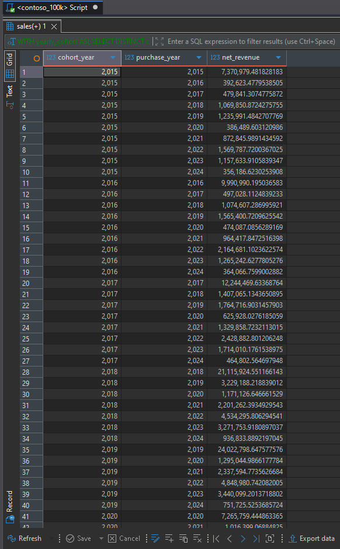
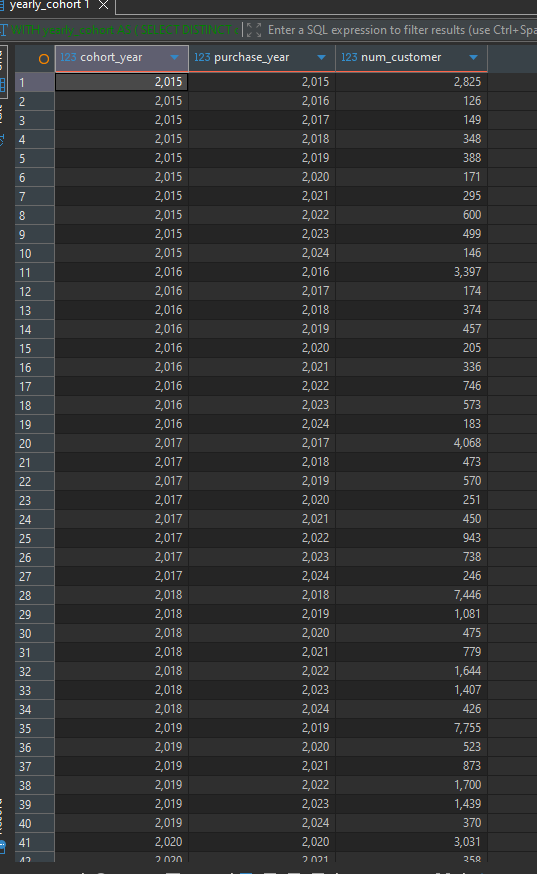
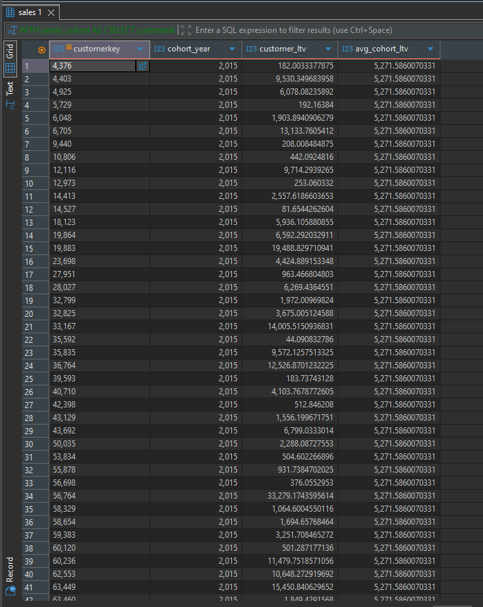

# Contoso Sales Analysis – Cohort and Lifetime Value

This folder is part of the **SQL PROJECT → Contoso Sales Analysis** series.

It focuses on customer acquisition cohorts, yearly revenue contribution, repeat purchasing activity, and Customer Lifetime Value (LTV) using SQL queries executed in **PostgreSQL**.

Each query demonstrates a practical application of cohort analysis, with insights based on the actual query results.

---

## 📂 Folder Structure

```text
SQL PROJECT
│
└── Contoso Sales Analysis
    │
    └── 4.Cohort_and_Lifetime_Value
        ├── 1.Revenue_by_Customer_Cohort_and_Purchase_Year.sql
        ├── 2.Customer_Activity_by_Acquisition_Cohort.sql
        ├── 3.Customer_Lifetime_Value_and_Average_Cohort_LTV.sql
        ├── README.md
        │
        └── result_snapshots/
            ├── 1.Revenue_by_Customer_Cohort_and_Purchase_Year.png
            ├── 2.Customer_Activity_by_Acquisition_Cohort.png
            └── 3.Customer_Lifetime_Value_and_Average_Cohort_LTV.png
```

---

## 🧩 Queries & Insights

### 1️⃣ Revenue by Customer Cohort and Purchase Year

**File:** `1.Revenue_by_Customer_Cohort_and_Purchase_Year.sql`

**Description:**

Calculates net revenue for each purchase year, grouped by the year in which customers made their first purchase.

This analysis shows how much revenue each acquisition cohort contributes in its initial year and in subsequent years.

**Result Snapshot:**



**Insights:**

- The 2015 cohort generated approximately **7.37 million** in its first purchase year.
- The 2018 cohort generated approximately **21.12 million** in its first purchase year.
- The 2019 cohort generated approximately **24.02 million**, while the 2022 cohort generated approximately **24.41 million** in their respective acquisition years.
- The 2023 cohort generated approximately **14.35 million** in its acquisition year.
- The 2024 cohort generated approximately **2.86 million** in its acquisition year. This figure should not be compared directly with earlier cohorts unless the reporting periods are comparable.
- Tracking revenue by cohort and purchase year helps distinguish initial-year revenue from revenue generated through later purchases.

---

### 2️⃣ Customer Activity by Acquisition Cohort

**File:** `2.Customer_Activity_by_Acquisition_Cohort.sql`

**Description:**

Counts the customers from each acquisition cohort who purchased in each subsequent year.

This analysis helps examine repeat purchasing and how customer activity changes after the initial acquisition year.

**Result Snapshot:**



**Insights:**

- The 2015 cohort contained **2,825 customers** in its acquisition year.
- The 2018 cohort contained **7,446 customers**, and the 2019 cohort contained **7,755 customers** in their respective acquisition years.
- The 2022 cohort had **9,010 customers** in its acquisition year, the largest initial-year customer count among the cohorts shown.
- For the 2015 cohort, **126 customers** purchased in 2016 and **600 customers** purchased in 2022.
- For the 2022 cohort, **1,764 customers** purchased in 2023 and **561 customers** purchased in 2024.
- Customer counts across later years help describe repeat-purchase activity. They should not automatically be interpreted as a retention rate unless the metric is divided by the original cohort size and defined consistently.

---

### 3️⃣ Customer Lifetime Value and Average Cohort LTV

**File:** `3.Customer_Lifetime_Value_and_Average_Cohort_LTV.sql`

**Description:**

Calculates each customer's lifetime revenue and the average lifetime revenue for customers in the same acquisition cohort.

This analysis compares individual customer value with the average value of the customer's cohort.

**Result Snapshot:**



**Insights:**

- For the 2015 acquisition cohort, the reported average customer LTV is approximately **5,271.59**.
- Individual customer LTV varies considerably within the same cohort. For example, the displayed 2015 cohort includes customers with lifetime revenue of approximately **182.00**, **9,530.35**, and **13,133.76**.
- This variation shows why a cohort average should be considered alongside the distribution of individual customer values.
- Comparing individual LTV with cohort-average LTV can help identify customers whose revenue contribution is above or below their cohort's average.
- LTV values for newer cohorts may be lower because those customers have had less time to purchase. Cohort comparisons should account for the length of the observation period.

---

## 🧠 Key Takeaways

- **Cohort revenue:** Grouping revenue by acquisition year shows how customer cohorts contribute to sales in their first year and in later years.
- **Repeat-purchase activity:** Annual customer counts show how many customers from earlier cohorts continue purchasing in subsequent years.
- **Customer lifetime value:** Individual LTV measures total customer revenue, while average cohort LTV provides a comparison point for customers acquired in the same year.
- **Customer value varies:** Customers in a single cohort can generate very different amounts of lifetime revenue.
- **Fair cohort comparisons matter:** Newer cohorts have shorter observation periods, so their revenue and LTV should not be compared directly with older cohorts without considering that difference.

---

## 🗄️ Database Info

- **Database:** Contoso sample sales database (`contoso_100k`)
- **Environment:** PostgreSQL
- **Queries Written & Executed In:** DBeaver
- **Data Areas Used:** Sales, Customer, Order Date, and Net Revenue fields

