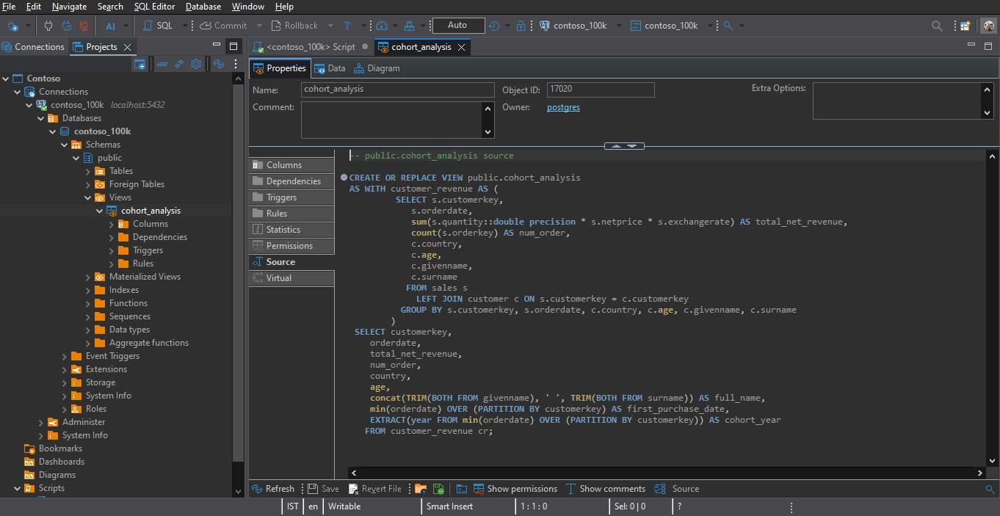
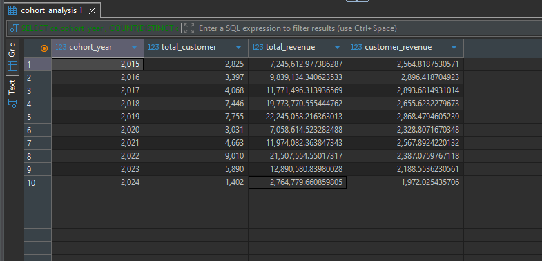
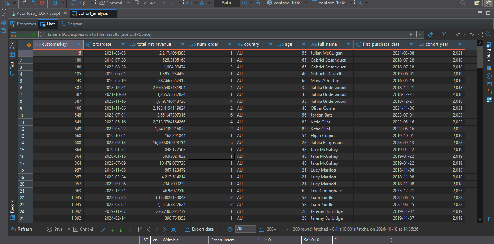

# Contoso Sales Analysis – Cohort View and First Purchase Metrics

This folder is part of the **SQL PROJECT → Contoso Sales Analysis** series.

It focuses on customer cohort reporting, first-purchase-date revenue, revenue per customer, and customer-name formatting using SQL views in **PostgreSQL**.

Each query demonstrates a practical application of reusable views and cohort analysis, with insights based on the supplied query results.

---

## 📂 Folder Structure

```text
SQL PROJECT
│
└── Contoso Sales Analysis
    │
    └── 5.Cohort_View_and_First_Purchase_Metrics
        ├── 1.View_Cohort_Customer_Revenue_Detail.sql
        ├── 2.Cohort_First_Day_Revenue_Per_Customer.sql
        ├── 3.View_Cohort_Customer_Name_Trimmed.sql
        ├── README.md
        │
        └── result_snapshots/
            ├── 1.View_Cohort_Customer_Revenue_Detail.png
            ├── 2.Cohort_First_Day_Revenue_Per_Customer.png
            └── 3.View_Cohort_Customer_Name_Trimmed.png
```

---

## 🧩 Queries & Insights

### 1️⃣ View: Cohort Customer Revenue Detail

**File:** `1.View_Cohort_Customer_Revenue_Detail.sql`

**Description:**

Creates a reusable view containing customer-level revenue aggregated by customer and order date. It includes customer information, order counts, full name, first purchase date, and cohort year.

The view makes it easier to query customer activity and perform further cohort-level analysis without repeating the underlying joins and calculations.

**Result Snapshot:**



**Insights:**

- The result includes customer key, order date, total net revenue, order count, country, age, full name, first purchase date, and cohort year.
- The displayed records show customers with multiple activity dates. For example, customer 387 has a first purchase date of 21 December 2018, with later purchases appearing in 2021 and 2023.
- The cohort year is derived from the customer's first purchase date, allowing customers to be grouped by acquisition year.
- Aggregating at customer-and-date level provides a reusable detail layer for additional reporting.

---

### 2️⃣ Cohort First-Day Revenue per Customer

**File:** `2.Cohort_First_Day_Revenue_Per_Customer.sql`

**Description:**

Summarizes each acquisition cohort by counting customers and calculating revenue recorded on their first purchase date, along with revenue per customer.

This provides a cohort-level view of first-purchase activity rather than total lifetime revenue.

**Result Snapshot:**



**Insights:**

- The **2022 cohort** has the largest customer count in the supplied results, with **9,010 customers**.
- The **2019 cohort** records the highest first-purchase-date revenue at approximately **22.25 million**, followed by the 2022 cohort at approximately **21.51 million**.
- The **2016 cohort** has the highest reported first-day revenue per customer at approximately **2,896.42**.
- The **2024 cohort** has the lowest reported first-day revenue per customer at approximately **1,972.03**.
- Revenue per customer varies across acquisition cohorts, showing that cohort size and first-purchase-date revenue per customer are different measures.
- These revenue figures represent revenue recorded on customers' first purchase dates, not their total lifetime revenue.

---

### 3️⃣ View: Cohort Customer Name Trimmed

**File:** `3.View_Cohort_Customer_Name_Trimmed.sql`

**Description:**

Creates a customer cohort view that formats customer names by trimming leading and trailing spaces from given names and surnames, then combining them into a full name.

The view also includes customer activity and cohort fields for easier downstream querying.

**Result Snapshot:**



**Insights:**

- The view returns a cleaned `full_name` field by combining trimmed given names and surnames.
- The supplied snapshot shows customer names alongside order dates, revenue, customer details, first purchase dates, and cohort years.
- Name standardization helps keep customer names consistent in query outputs and downstream reports.
- The screenshot demonstrates the view's output structure; it does not independently establish how many names required trimming.

---

## 🧠 Key Takeaways

- **Reusable views:** Views simplify repeated customer-level and cohort-level analysis.
- **Cohort assignment:** First purchase dates provide the basis for grouping customers by acquisition year.
- **First-purchase revenue:** Revenue recorded on the first purchase date can be compared across cohorts, but it should not be confused with lifetime revenue.
- **Cohort size versus value:** A cohort with more customers does not necessarily have the highest revenue per customer.
- **Data presentation:** Trimming customer names helps produce cleaner, more consistent reporting fields.

---

## 🗄️ Database Info

- **Database:** Contoso sample sales database (`contoso_100k`)
- **Environment:** PostgreSQL
- **Queries Written & Executed In:** DBeaver
- **Data Areas Used:** Sales and Customer fields, including order date, net revenue, customer details, first purchase date, and cohort year

---


**Author:** Utkarsh Naik

**Project:** SQL PROJECT → Contoso Sales Analysis → Cohort View and First Purchase Metrics

**Date:** 2026