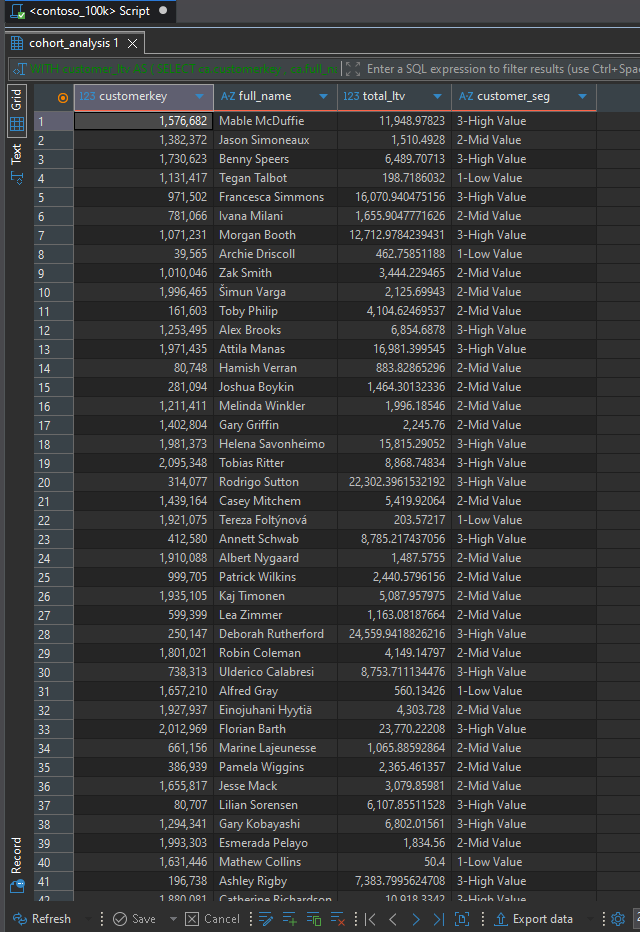

# Contoso Sales Analysis – Customer LTV Segmentation

This folder is part of the **SQL PROJECT → Contoso Sales Analysis** series.

It focuses on segmenting customers by lifetime revenue using percentile-based thresholds and summarizing revenue contribution across low-, medium-, and high-value customer groups. The queries were executed in **PostgreSQL** using the Contoso sample sales database.

Each query is documented with its purpose and insights drawn from the supplied result snapshots.

---

## 📂 Folder Structure

```text
SQL PROJECT
│
└── Contoso Sales Analysis
    │
    └── 6.Customer_LTV_Segmentation
        ├── 1.Customer_LTV_Segmentation.sql
        ├── 2.LTV_Summary_by_Customer_Segment.sql
        ├── README.md
        │
        └── result_snapshots/
            ├── 1.Customer_LTV_Segmentation.png
            └── 2.LTV_Summary_by_Customer_Segment.png
```

---

## 🧩 Queries & Insights

### 1️⃣ Customer Lifetime Value Segmentation

**File:** `1.Customer_LTV_Segmentation.sql`

**Description:**

Calculates total lifetime revenue for each customer and assigns a customer segment using the 25th and 75th percentiles. Customers are classified as **Low Value**, **Mid Value**, or **High Value** based on their lifetime revenue.

**Result Snapshot:**



**Insights:**

- The output includes each customer's key, name, total lifetime value, and assigned segment.
- The results show a broad range of customer lifetime revenue, from very low values to customers generating tens of thousands in revenue.
- Customers such as **Deborah Rutherford**, **Rodrigo Sutton**, and **Florian Barth** appear in the high-value segment in the supplied output.
- Customers with comparatively small lifetime revenue, such as **Matilda Kingery** and **Robert Jordan**, appear in the low-value segment.
- Percentile-based segmentation creates relative groups based on the distribution of customer LTV rather than relying on manually selected fixed revenue thresholds.

---

### 2️⃣ Lifetime Value Summary by Customer Segment

**File:** `2.LTV_Summary_by_Customer_Segment.sql`

**Description:**

Aggregates the customer-level segmentation results to compare total lifetime revenue, customer count, and average lifetime value for each segment.

**Result Snapshot:**


**Insights:**

- The **Mid Value** segment contains **24,743 customers**, the largest customer count among the three segments.
- The **Low Value** and **High Value** segments each contain **12,372 customers**.
- The **High Value** segment contributes approximately **135.43 million** in total lifetime revenue, the highest among the segments.
- The **Mid Value** segment contributes approximately **66.64 million**, while the **Low Value** segment contributes approximately **4.34 million**.
- Average lifetime value is approximately **10,946.43** for High Value customers, **2,693.14** for Mid Value customers, and **350.94** for Low Value customers.
- The results show that the high-value segment generates the greatest total revenue despite having roughly half as many customers as the mid-value segment.

---

## 🧠 Key Takeaways

- **Percentile-based segmentation** groups customers according to their relative lifetime revenue.
- **High Value customers** generate the largest share of the lifetime revenue represented in the summary.
- **Mid Value customers** make up the largest segment by customer count.
- Average customer LTV differs substantially across the three groups, supporting differentiated customer strategies.
- The segmentation can help prioritize retention efforts, customer engagement, and further analysis of high-value customer behavior.

---

## 🗄️ Database Info

- **Database:** Contoso sample sales database (`contoso_100k`)
- **Environment:** PostgreSQL
- **Queries Written & Executed In:** PostgreSQL / DBeaver
- **Data Areas Used:** Customer and Sales data, including customer key, customer name, and total net revenue

---


**Author:** Utkarsh Naik

**Project:** SQL PROJECT → Contoso Sales Analysis → Customer LTV Segmentation

**Date:** 2026