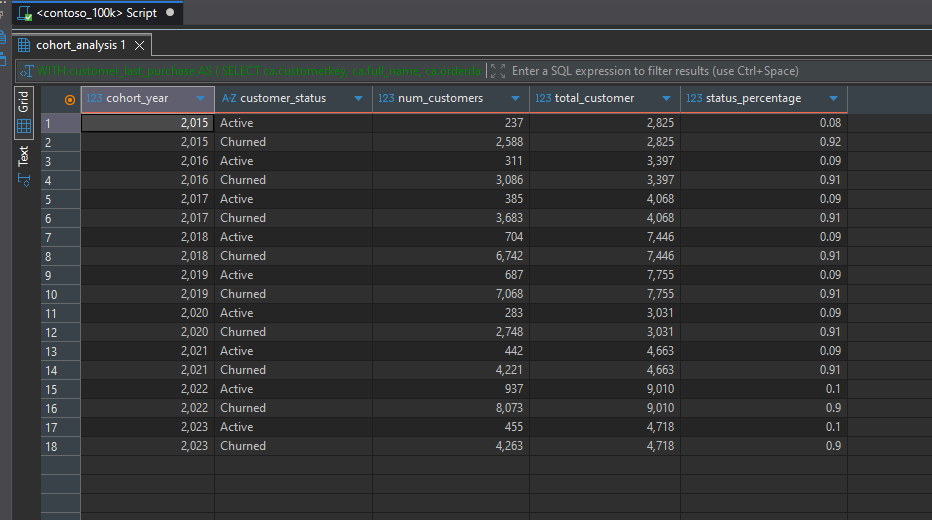

# Contoso Sales Analysis – Customer Retention and Churn

This folder is part of the **SQL PROJECT → Contoso Sales Analysis** series.

It focuses on measuring customer activity and churn by acquisition cohort using SQL in **PostgreSQL**. The query compares customers classified as active or churned within each cohort and calculates each status group's share of the cohort.

---

## 📂 Folder Structure

```text
SQL PROJECT
│
└── Contoso Sales Analysis
    │
    └── 7.Customer_Retention_and_Churn
        ├── 1.Customer_Retention_and_Churn.sql
        ├── README.md
        │
        └── result_snapshots/
            └── 1.Customer_Retention_and_Churn.png
```

---

## 🧩 Query & Insights

### 1️⃣ Customer Retention and Churn by Cohort

**File:** `1.Customer_Retention_and_Churn.sql`

**Description:**

Classifies customers in each acquisition cohort as **Active** or **Churned**, then reports the number of customers in each status, the total cohort size, and the percentage represented by each status.

This helps compare the active and churned customer counts across cohorts.

**Result Snapshot:**



**Insights:**

- In the displayed results, the 2015 cohort contains **2,825 customers**: **237 Active (8%)** and **2,588 Churned (92%)**.
- The 2018 cohort contains **7,446 customers**: **704 Active (9%)** and **6,742 Churned (91%)**.
- The 2022 cohort contains **9,010 customers**: **937 Active (10%)** and **8,073 Churned (90%)**.
- The 2023 cohort contains **4,718 customers**: **455 Active (10%)** and **4,263 Churned (90%)**.
- Across the displayed cohorts, the Active share is approximately **8–10%**, while the Churned share is approximately **90–92%**.
- The largest displayed cohort is 2022, with **9,010 customers**. It also has the largest absolute number of active customers among the displayed cohorts (**937**).
- These percentages describe the classifications in this query. The business meaning of “Active” and “Churned” depends on the SQL logic used to define customer status.

---

## 🧠 Key Takeaways

- **Cohort-level monitoring** makes it possible to compare customer status across acquisition years.
- The displayed results show a substantially larger Churned group than Active group in every cohort.
- The active share ranges from approximately **8% to 10%** in the displayed output.
- The cohort with the largest customer base may also have the largest number of active customers, even when its active percentage is similar to other cohorts.
- Consistent status definitions and observation periods are important when interpreting retention and churn metrics.

---

## 🗄️ Database Info

- **Database:** Contoso sample sales database (`contoso_100k`)
- **Environment:** PostgreSQL
- **Queries Written & Executed In:** PostgreSQL / DBeaver
- **Data Areas Used:** Customer cohort, customer status, customer counts, and status percentages

---


**Author:** Utkarsh Naik

**Project:** SQL PROJECT → Contoso Sales Analysis → Customer Retention and Churn

**Date:** 2026