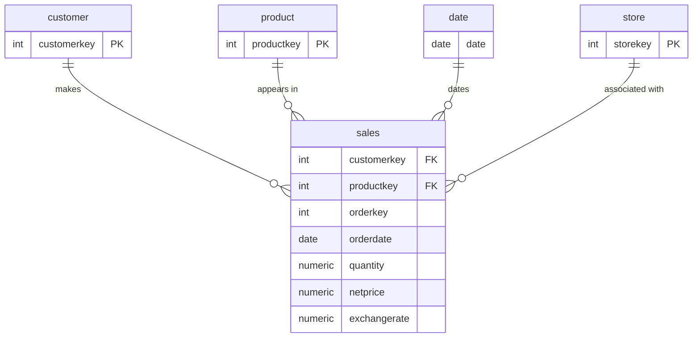

## Contoso Sales Analysis – SQL Portfolio Project
---

## Overview

This project explores sales and customer data from the **Contoso sample database** using SQL.

The goal is to answer business-relevant questions such as:
- How does revenue vary by product category and over time?
- How can customer purchasing behavior be analyzed?
- How can revenue be compared using medians and percentiles?
- What can customer cohort analysis reveal about purchasing patterns and lifetime value?
- How can window functions support rankings, running calculations, and moving averages?
- How can customers be segmented by lifetime value and evaluated for retention and churn?

Each analysis area is organized into its own folder containing SQL queries. Folder-level README files, query results, and visualizations will be added as the project develops.

---

## Analysis Areas Covered

1. **Revenue and Product Analysis** → Analyze revenue, compare product categories, and use median and percentile-based measures.
2. **Customer and Time Trends** → Explore customer activity, monthly revenue trends, and order-to-delivery timing.
3. **Window Function Analysis** → Use ranking, running calculations, revenue contribution, and moving averages.
4. **Cohort and Lifetime Value** → Analyze customer cohorts and revenue across purchase periods.
5. **Cohort Views and First-Purchase Metrics** → Create reusable cohort views and examine first-purchase metrics.
6. **Customer LTV Segmentation** → Segment customers by lifetime value and summarize segment performance.
7. **Customer Retention and Churn** → Analyze customer activity and retention-related metrics.

---

## Tech Stack

- **SQL:** PostgreSQL
- **Database:** Contoso sample sales database
- **Core tables:** `sales`, `customer`, `product`, `store`, and `date`
- **Analysis techniques:** Joins, aggregations, CTEs, views, window functions, date/time functions, percentiles, cohort analysis, customer lifetime value, and segmentation
- **Visualization:** Query-result screenshots and visualizations will be added later.

---

## Schema Diagram

The following is a simplified conceptual overview of the main tables used in the analysis.

---

## SQL Skills Demonstrated

- Filtering, sorting, and date-range analysis
- Joins and aggregations using `GROUP BY`
- Common table expressions (CTEs) and reusable views
- Conditional logic using `CASE`
- Median and percentile calculations
- Window functions, including `ROW_NUMBER`, `RANK`, `DENSE_RANK`, `LAG`, and `LEAD`
- Running calculations, moving averages, and month-over-month comparisons
- Customer cohort analysis and lifetime value (LTV)
- Customer segmentation and retention/churn analysis

---

## Why This Project Matters

This project demonstrates the application of SQL to sales performance and customer behavior analysis. It focuses on:

- Translating business questions into SQL queries
- Analyzing revenue by product, customer, and time period
- Applying window functions and statistical thresholds to sales data
- Building cohort and customer lifetime value analyses
- Organizing analytical queries into a structured GitHub portfolio

The project will be expanded with detailed folder-level documentation, validated query results, and visualizations as those components are completed.

---
