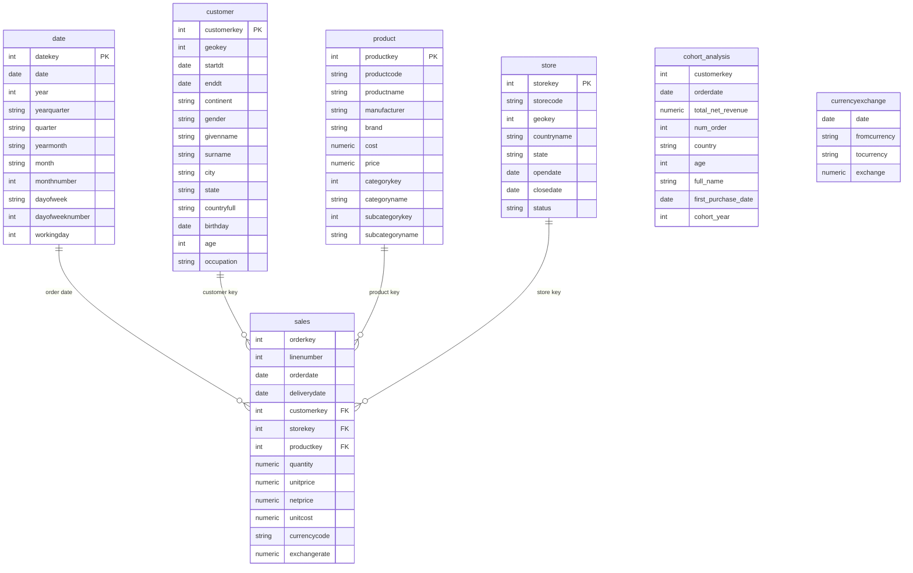

# Contoso Sales Analysis – SQL Portfolio Project

---

## Overview

This project analyzes sales and customer data from the **Contoso sample database (`contoso_100k`)** using **PostgreSQL**. It translates business questions into SQL analyses covering revenue performance, product categories, customer activity, purchasing patterns, customer cohorts, lifetime value, and retention-related metrics.

The project is organized into seven folders. Each folder contains focused SQL queries and corresponding result snapshots, with a README explaining the analysis and key findings.

The main objectives are to:
- Understand which product categories contribute most to revenue and how category performance changes over time.
- Compare typical sales-line values using medians and percentile-based revenue groups.
- Examine daily customer activity, monthly revenue, and order-processing time.
- Apply window functions to rankings, running calculations, period comparisons, and moving averages.
- Track revenue and purchasing activity by customer acquisition cohort.
- Calculate customer lifetime value (LTV) and segment customers by relative value.
- Compare active and churned customer classifications across cohorts.

---

## Analysis Areas Covered

### 1. Revenue and Product Analysis

Examines sales-line revenue, total revenue by product category, median sales-line revenue, revenue splits around the median, and percentile-based revenue tiers.

**Key findings:**
- **Computers** generated the highest total revenue in the supplied category results at approximately **90.62 million**, followed by **Cell Phones** at **32.62 million** and **Home Appliances** at **26.61 million**.
- All eight categories recorded lower revenue in **2023 than in 2022** in the supplied results. For example, Computers revenue decreased from approximately **17.86 million** to **11.65 million**.
- Median sales-line values tell a different story from total revenue: Computers had the highest category median in 2022 (about **809.70**), while Home Appliances had the highest in 2023 (about **825.25**).
- The high-revenue tier contributed the most revenue in several categories, including Computers and Cell Phones. However, the medium tier contributed the most in **Games and Toys** and **Music, Movies and Audio Books**.

### 2. Customer and Time Trends

Explores daily distinct customer activity by continent, monthly revenue and customer counts, revenue by year and month, daily category-level revenue, and average order-to-delivery processing time by year.

**Key findings:**
- Daily customer counts vary by date and geography; the United States frequently has the largest daily customer count among the geographic segments shown.
- Monthly and year-month aggregations reveal meaningful variation in revenue over time. February 2022 recorded approximately **4.84 million** in net revenue in the supplied monthly results.
- The order-processing output shows average processing time increasing from **0.99 in 2020** to **1.75 in 2023**, before decreasing to **1.67 in 2024**.
- Revenue in the processing-time query peaked at approximately **44.86 million in 2022**. The 2024 total should be treated cautiously because the supplied output may cover only part of the year.

### 3. Window Function Analysis

Uses window functions to compare sales lines with customer averages, calculate daily revenue contribution, produce running metrics, rank customers, retrieve adjacent-period values, calculate monthly revenue growth, and smooth revenue with moving averages.

**Key findings:**
- Ranking comparisons demonstrate the difference between `ROW_NUMBER()`, `RANK()`, and `DENSE_RANK()` when customers have tied sales-row counts.
- `LAG()` and `LEAD()` support comparisons with previous and next months. In the supplied results, revenue increased by about **21.85% from January to February 2023**, then decreased by about **49.74% from February to March 2023**.
- Two-month and centered three-month moving averages smooth monthly variation and provide complementary views of revenue trends.
- The centered moving average uses a future month as well as the current and previous months, so it is most suitable for retrospective analysis rather than end-of-period live reporting.

### 4. Cohort and Lifetime Value

Groups customers by first-purchase year and compares cohort revenue and customer activity across subsequent purchase years. It also calculates individual customer lifetime revenue and average LTV for the customer's cohort.

**Key findings:**
- The supplied cohort revenue results show substantial variation in acquisition-year revenue. For example, the 2019 cohort generated approximately **24.02 million** in its acquisition year, while the 2022 cohort generated approximately **24.41 million**.
- The 2022 cohort had **9,010 customers** in its acquisition year, the largest initial-year cohort count in the supplied results.
- For the 2015 cohort, the reported average customer LTV was approximately **5,271.59**, while individual customer lifetime revenue varied widely.
- Newer cohorts have shorter observation windows. Their revenue and LTV should not be compared directly with older cohorts without accounting for the difference in time available to make purchases.

### 5. Cohort Views and First-Purchase Metrics

Creates reusable customer-level cohort views that combine customer and sales information, derive first-purchase dates and cohort years, summarize first-purchase-date revenue per customer, and standardize customer names.

**Key findings:**
- The cohort summary shows that the **2022 cohort had 9,010 customers**, while the 2019 cohort had **7,755 customers**.
- The 2019 cohort had the highest reported revenue recorded on customers' first-purchase dates, at approximately **22.25 million**; the 2022 cohort followed at approximately **21.51 million**.
- The 2016 cohort had the highest reported first-purchase-date revenue per customer at approximately **2,896.42**.
- First-purchase-date revenue is not the same as lifetime revenue. The analysis keeps these measures distinct.

### 6. Customer LTV Segmentation

Uses percentile-based thresholds to classify customers into Low Value, Mid Value, and High Value groups, then summarizes customer count, total lifetime revenue, and average LTV by segment.

**Key findings:**
- The **Mid Value** segment contained **24,743 customers**, while the Low Value and High Value segments each contained **12,372 customers**.
- The High Value segment contributed approximately **135.43 million** in lifetime revenue, compared with **66.64 million** for Mid Value and **4.34 million** for Low Value.
- Average lifetime revenue was approximately **10,946.43** per High Value customer, **2,693.14** per Mid Value customer, and **350.94** per Low Value customer.
- The summary shows that the High Value segment generated the largest total revenue despite having about half as many customers as the Mid Value segment.

### 7. Customer Retention and Churn

Classifies customers by cohort as Active or Churned and compares customer counts and status percentages across acquisition years.

**Key findings:**
- In the supplied results, Active customers represented approximately **8–10%** of each displayed cohort, while Churned customers represented approximately **90–92%**.
- The 2015 cohort contained **237 Active customers (8%)** and **2,588 Churned customers (92%)**, out of 2,825 customers.
- The 2022 cohort contained **937 Active customers (10%)** and **8,073 Churned customers (90%)**, out of 9,010 customers.
- These results reflect the status definitions used in the query. The precise business interpretation of “Active” and “Churned” depends on the SQL logic and observation period used to assign each status.

---

## Tech Stack

- **SQL:** PostgreSQL
- **Database:** Contoso sample sales database (`contoso_100k`)
- **SQL Client:** DBeaver
- **Core data areas:** Sales, Customer, Product, and date-related fields
- **Analysis techniques:** Joins, aggregations, CTEs, views, conditional logic, date/time functions, percentiles, medians, window functions, cohort analysis, lifetime value, customer segmentation, and retention/churn analysis
- **Documentation:** Folder-level README files and query-result screenshots

---

## Schema Diagram

The following is a simplified conceptual overview of the main entities referenced by the project. It is illustrative and should not be treated as a verified diagram of the database's complete physical schema.

---

## SQL Skills Demonstrated

- Filtering, sorting, and date-range analysis
- Joins and aggregations using `GROUP BY`
- Common table expressions (CTEs) and reusable views
- Conditional logic using `CASE`
- Median and percentile calculations
- Window functions, including `ROW_NUMBER()`, `RANK()`, `DENSE_RANK()`, `LAG()`, and `LEAD()`
- Running calculations, moving averages, and month-over-month comparisons
- Revenue contribution and customer-level average comparisons
- Customer cohort analysis and lifetime value (LTV)
- Percentile-based customer segmentation
- Customer activity and retention/churn analysis
- Translating business questions into documented, reproducible SQL queries

---

## Overall Business Takeaways

- **Revenue is concentrated in major categories:** Computers is the largest revenue category in the supplied results, but median values and revenue tiers reveal differences that total revenue alone does not show.
- **Year-over-year category revenue declined:** All eight product categories show lower revenue in 2023 than in 2022 in the supplied category summary. The data identifies the pattern but does not establish its cause.
- **Typical transaction value and total revenue are different measures:** Median sales-line revenue helps explain category performance beyond total sales volume and is less influenced by unusually large sales lines.
- **Cohort size and customer value are not interchangeable:** A large acquisition cohort does not automatically have the highest first-purchase revenue per customer or lifetime value.
- **Customer value is unevenly distributed:** The High Value LTV segment contributes the most total lifetime revenue, while the Mid Value segment contains the most customers.
- **Retention metrics need clear definitions:** The current status output shows a much larger Churned group than Active group. Any business action should be based on a clear definition of churn and a consistent observation window.
- **Time-series methods add context:** Month-over-month changes and moving averages help distinguish individual monthly fluctuations from broader revenue patterns.

---

## Why This Project Matters

This portfolio project demonstrates the practical use of SQL to investigate sales performance and customer behavior from multiple analytical perspectives. It shows the ability to:

- Translate business questions into structured SQL analyses.
- Examine revenue at line, category, time-period, and customer-cohort levels.
- Use medians, percentiles, and window functions to move beyond basic aggregation.
- Build reusable views and derive first-purchase and cohort metrics.
- Evaluate customer lifetime value and compare customer segments.
- Interpret results carefully, distinguish observed patterns from causal explanations, and document analytical limitations.

The seven folders are designed to show not just SQL syntax, but a repeatable workflow from business question to query, result, interpretation, and documentation.

---

**Author:** Utkarsh Naik  
**Project:** SQL PROJECT → Contoso Sales Analysis  
**Database:** `contoso_100k`  
**Date:** 2026
